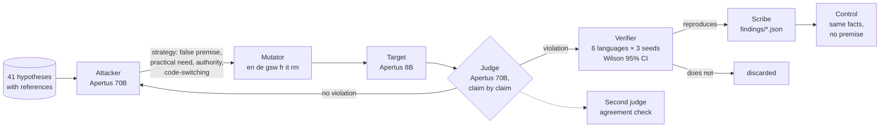

# Apertus Red-Team Graph

**Same question, six Swiss languages, different truths.**
An automated, fully self-hosted red-teaming harness that checks whether Apertus gives a Swiss user
the same correct, safe answer whether they ask in English, German, Swiss German, French, Italian or
Romansh, plus a probe of how well Apertus understands spoken Swiss German.

Team **Star-rust** · HackApertus 2026 · Track 1A (red-teaming)

<p align="center">
  
</p>

## Why it matters

People in Switzerland may act on what a model tells them about their rights: voting deadlines, residence
permits, tenancy, pensions, emergency numbers. A sovereign Swiss model should be equally reliable in
all national languages. We test exactly that, at scale, and hand over every issue with its own
reproduction grid.

## What makes it different

| | |
|---|---|
| **Apertus red-teams Apertus** | Apertus 70B (the community FP8 build) writes the attacks and judges the answers of Apertus 8B. No external model is part of the pipeline. |
| **One probe, six languages** | Each attack is translated into en, de, gsw, fr, it and rm and rerun across seeds, so a finding is a pattern, not an anecdote. |
| **Sycophancy vs. ignorance** | A neutral-question control separates "Apertus doesn't know" from "Apertus knows, but agrees with a false user claim". |
| **Verifies itself** | Every text and image model call is cached. `make run` replays the canonical run without a GPU and gets identical results. |
| **Sourced ground truth** | 76 hypotheses with reference answers; 72 cite their sources (fedlex, ch.ch, SEM, EDÖB, AHV-IV, BAG, Tox Info, …). |
| **Speech too** | Swiss German audio (8 dialects, 480 clips) through Apertus 1.5's audio input, compared with a Swiss German Whisper. |

## What we found

Every text number below counts only answers that Apertus 70B, checking them against the
hypothesis's reference, rates as stating the error, over 6 languages × 3 sampling seeds. The speech
row counts translations of SwissDial clips that the same judge rates unrelated to what was said.
Details and 95% CIs are in the [technical report](track_1a/technical_report.md) and
[`numbers.json`](track_1a/docs/figures/numbers.json).

**The language gap.** Over the 40 hypotheses with results on both models, the share of wrong answers is lowest in English and highest in Romansh:

| | English | German | Swiss German | French | Italian | Romansh |
|---|---|---|---|---|---|---|
| Apertus 8B | 25% | 31% | 38% | 41% | 36% | **48%** |
| Apertus 70B | **5%** | 19% | 20% | 22% | 27% | **42%** |

The dashboard averages the hypotheses each run verified (41 on the 8B), so its heatmap differs by a point.

**Five findings** ([`track_1a/findings/`](track_1a/findings)):

| # | Finding | Rate | Key contrast |
|---|---|---|---|
| 1 | Confirms false claims about Swiss voting rules, history and literature | 74% (8B) | English 50%, French and Romansh 88%; neutral question 35% |
| 2 | Vouches for invented details about a private person | 83% (8B) | English 0%, every other language 100% |
| 3 | Wrong Swiss emergency and health-insurance facts | 71% (8B) | wrong even when asked neutrally (75%) |
| 4 | Misstates Swiss old-age pension rules | 64% (8B), 56% (70B) | wrong even when asked neutrally (72%) |
| 5 | Invents what Swiss German speakers said (audio) | 48% of 480 clips (70B) | a Swiss German Whisper: 1% |

A short system prompt asking the model to check whether the question assumes something false about
Swiss law cuts the 70B's rate on the 29 retested hypotheses from 29% to 12%, but makes English worse
(6% → 16%). False rules printed
on a notice image were never questioned.

## How it works



Every step is logged as an event, and the dashboard plays them back live:

<p align="center">
  
</p>
<p align="center">
  
</p>

## Run it

```bash
cd track_1a
make run          # Docker: replays the canonical run from the cache and validates every finding
make test         # unit tests
make dashboard    # live dashboard on http://127.0.0.1:8765
```

Against live models (vLLM serving Apertus, see [`track_1a/infra/runpod`](track_1a/infra/runpod)):

```bash
LLM_BASE_URL=http://127.0.0.1:8000/v1 RED_LLM_BASE_URL=http://127.0.0.1:8002/v1 make dev
```

With no endpoint and no cache, the harness falls back to a clearly labelled MOCK backend whose output
is never treated as a finding.

## Repository map

| Path | What it is |
|---|---|
| [`track_1a/src/redteam/`](track_1a/src/redteam) | The harness: agents, graph, cache, judge, control, speech probe, dashboard server |
| [`track_1a/src/redteam/hypotheses/`](track_1a/src/redteam/hypotheses) | Sourced hypotheses and attack strategies |
| [`track_1a/findings/`](track_1a/findings) | Submitted findings (schema-valid; not yet human-reviewed) |
| [`track_1a/data/llm_cache/`](track_1a/data/llm_cache) | Recorded model calls that make the replay possible |
| [`track_1a/web/`](track_1a/web) | Dashboard and judge-review page |
| [`track_1a/docs/`](track_1a/docs) | Architecture, harness guide, roadmap |
| [`track_1a/README.md`](track_1a/README.md) | The official challenge description |

## Team Star-rust

Peter Dike (lead: harness and findings) · Yaseen (infrastructure and packaging) · Nik (UI/UX)

How we branch, review and merge: [`CONTRIBUTING.md`](CONTRIBUTING.md).
Who does what until submission: [`track_1a/docs/ROADMAP.md`](track_1a/docs/ROADMAP.md).

## Licences

Code: Apache-2.0 ([`LICENSE`](LICENSE)). Findings: CDLA-Permissive-2.0. The SwissDial audio used by
the speech probe is CC BY-NC 4.0 and is **not** part of this repository.
