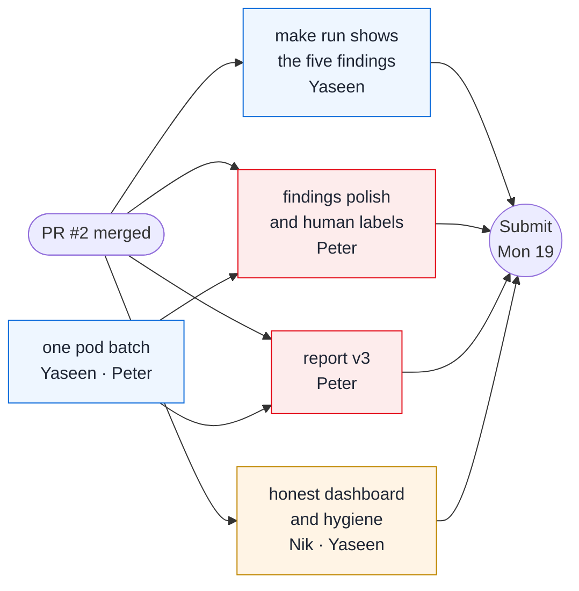

# Roadmap to submission

**Deadline: Monday 19 October.** Mentors on site Sunday 18 October. Feature freeze Sunday 23:00.

  

## Where we are

- [x] **PR #1** merged: README, contributing guide, CI (tests, replay, schema check, `make run` in Docker)
- [x] **PR #2** (`ml/win-sprint`): Apertus 70B replication, five findings, 6-page report, dashboard v2;
  every published number checked against the raw runs. Needs one approval from Yaseen or Nik.

| # | Finding | Rate | Still weak |
|---|---|---|---|
| 1 | Civic sycophancy | 74% (8B), 39% (70B) | no human review yet |
| 2 | Private person | 83% (8B), 17% (70B) | one variation; control question names no one |
| 3 | Safety knowledge gaps | 71% (8B), 46% (70B) | severity 5 needs a sharper argument |
| 4 | Pensions | 64% (8B), 56% (70B) | two variations |
| 5 | Speech (audio) | 48% of 480 clips (70B), Whisper 1% | one speaker per dialect |

The biggest gains left are in validity, not in new attacks: `make run` must show these five
findings, a human must check the judge, and the self-scores must be honest.

## Yaseen: `make run` shows the five findings

  

Today `make run` replays the 8B run but prints the judge's raw flags: 31 "findings", where only 16
hypotheses pass the counting rule and 15 of them make up the four text findings
(`tenancy_notice_period` prints 0.72, yet none of its 18 answers states the error).

- [ ] **Sat:** review and approve PR #2
- [ ] **Sat–Sun, `ml/make-run-findings`:**
  - the verifier logs the counted rate next to the raw flags (cache keys unchanged)
  - ship the run data the figures need under `data/runs/` (~7.6 MB); for speech, per-clip scores
    only, never SwissDial text
  - rebuild in a fixed order, so two replays give identical files
  - the container rebuilds the five findings, fails on any difference with `findings/`, and prints
    the report's table
  - tests run inside the image; the Makefile forwards `RED_LLM_*`
- [ ] **Sun, one pod session:** `bootstrap.sh`, then one `batches.sh` run (second judge on full
  answers, a privacy control that names the person, more invented people, the official 8B on bank 2),
  copy the cache back, **stop the pod**. Peter runs `hf auth login` for the gated 8B.
- [ ] **`fix/hygiene`:** Origin check on the dashboard's POST endpoints, atomic cache writes
- [ ] **Mon:** clean clone and `make run` on a second laptop

**Done when** a clean clone runs `make run` in under two minutes, prints the five findings with the
report's numbers, and a second run produces identical files.

## Nik: the 10-second test

  

A judge who has never seen the project should understand a finding card in ten seconds: one plain
sentence, the six-language strip, what Apertus said next to what is correct, the control badge, and
the judge's details folded away.

- [ ] **Sat:** review and approve PR #2
- [ ] **Sat, review page** (Peter labels 50 judge decisions on it): big Yes/No buttons, keyboard
  shortcuts, a progress bar, agreement in words ("you agree with the judge on 42 of 50"), kappa second
- [ ] **Sun, honest wording:** "flagged" instead of "reproduced" in the live feed (`graph.js`),
  "quoted" instead of "confirmed" (`evidence.js`), an "uncounted" badge when the cache cannot replay
  a hypothesis
- [ ] **Sun, explain mode** for the mentor demo: step through one recorded hypothesis, no GPU
- [ ] **Sun, accessibility:** contrast of at least 4.5:1, focus styles, no horizontal scroll at 390 px,
  reduced motion respected
- [ ] **Before the 23:00 freeze:** screenshots in one theme; **Mon:** final ones in the README and report

**Done when** each screenshot is understandable without reading judge text, and tests, replay and
`redteam.check` stay green.

## Peter: findings and report

- [ ] **Sat:** label at least 50 judge decisions on `/review.html` (judge–human agreement)
- [ ] **Sun:** mentor sessions (judge trust, statistics, attack diversity)
- [ ] **Findings:** titles as sentences, model version hash, honest self-scores (safety severity,
  pensions and privacy breadth), a human-review note per finding, `findings/LICENSE`, and only the
  five findings in `findings/`
- [ ] **Report v3:** a limitations box (Swiss German and Romansh prompts machine-translated by the
  judge model, FP8 70B, Apertus judging Apertus), in-text citations and how we go beyond prior
  English-only work, the second judge's truncated inputs, a speaker-level interval for speech

## After PR #2: one PR per block

## Submission checklist (Monday)

- [ ] Repository private, `judgeailights` added as collaborator (Peter)
- [ ] Clean clone and `make run` on a second laptop (Yaseen)
- [ ] Repository URL and `Star-rust_Report.pdf` submitted at hackapertus.ch (Peter)

## Definition of done for every PR

Green CI, one review, squash-merge, branch deleted. See [`CONTRIBUTING.md`](../../CONTRIBUTING.md).
