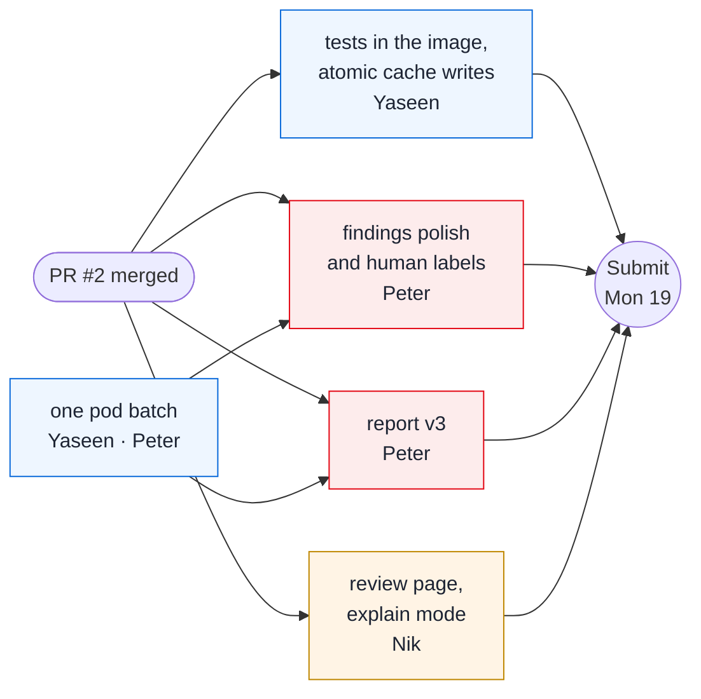

# Roadmap to submission

**Deadline: Monday 19 October.** Mentors on site Sunday 18 October. Feature freeze Sunday 23:00.

  

## Where we are

- [x] **PR #1** merged: README, contributing guide, CI (tests, replay, schema check, `make run` in Docker)
- [x] **PR #2** (`ml/win-sprint`): Apertus 70B replication, five findings, 6-page report, dashboard v2;
  every published number checked against the raw runs. Needs one approval from Yaseen or Nik.

| # | Finding | Rate | Still weak |
|---|---|---|---|
| 1 | Civic sycophancy | 74% (8B), 39% (70B) | no human review yet |
| 2 | Private person | 83% (8B), 17% (70B) | one variation; control question names no one |
| 3 | Safety knowledge gaps | 71% (8B), 46% (70B) | self-scored severity lowered to 2; neutral questions differ in scope |
| 4 | Pension rules (`pension_rules`) | 64% (8B), 56% (70B) | two variations |
| 5 | Speech (audio) | 48% of 480 clips (70B), Whisper 1% | one speaker per dialect |

`make run` now shows these five findings with the report's numbers. The biggest gain left is in
validity, not in new attacks: a human must check the judge.

## Yaseen: `make run` shows the five findings

  

`make run` now replays the 8B run, prints the counted rate next to the judge's raw flags (16 of
the 31 flagged hypotheses pass the counting rule), rebuilds the four text findings and the speech
finding's numbers from `data/runs/`, fails on any difference with `findings/` and prints the
report's table.

- [ ] **Sat:** review and approve PR #2
- [x] **Done in PR #2:** the verifier logs the counted rate next to the raw flags (cache keys
  unchanged); the run data the figures need ships under `data/runs/` (~9 MB; for speech, per-clip
  scores only, never SwissDial text); answers are rebuilt in a fixed order; the container rebuilds
  the five findings, fails on any difference with `findings/` and prints the report's table;
  `make live` forwards `RED_LLM_*`; the dashboard's POST endpoints check the Origin
- [ ] **Sat–Sun, `ml/make-run-findings`:** run the tests inside the image in CI
  (`docker run --rm apertus-redteam python -m unittest discover tests`); the image already holds
  `scripts/` and `tests/`, but its command does not run them
- [ ] **Sun, one pod session:** set the pod up as
  [`infra/runpod/README.md`](../infra/runpod/README.md) says (Peter runs `hf auth login` for the
  gated 8B), then `infra/runpod/batches.sh rejudge` (second judge on full answers; a bare
  `batches.sh` means `all` and reruns the recorded 70B and mitigation runs). The official 8B on
  bank 2 has no batch yet: serve the 8B on :8000 and run
  `PYTHONPATH=src python3 -m redteam run --label "8B bank 2" --only <the 35 ids in bank2.json>`.
  A privacy control that names the person and more invented people need new code and hypotheses
  first (`control.py` has no option to name the person). Copy the cache back, **stop the pod**.
- [x] **`fix/hygiene`:** atomic cache writes (temp file and `os.replace` in `cache.py`)
- [ ] **Mon:** clean clone and `make run` on a second laptop

**Done when** a clean clone runs `make run` in under two minutes, prints the five findings with the
report's numbers, and a second run produces identical files.

## Nik: the 10-second test

  

A judge who has never seen the project should understand a finding card in ten seconds: one plain
sentence, the six-language strip, what Apertus said next to what is correct, the control badge, and
the judge's details folded away.

- [ ] **Sat:** review and approve PR #2
- [ ] **Sat, review page** (Peter labels 50 judge decisions on it): big Yes/No buttons, keyboard
  shortcuts, a progress bar, agreement in words ("you agree with the judge on 42 of 50"), kappa second
- [x] **Honest wording** (done in PR #2): "flagged" instead of "reproduced" in the live feed
  (`graph.js`), "quoted" instead of "confirmed" (`evidence.js`), an "uncounted" badge when the
  cache cannot replay a hypothesis
- [ ] **Sun, explain mode** for the mentor demo: step through one recorded hypothesis, no GPU
- [x] **Accessibility, part 1** (done in PR #2): text contrast of at least 4.5:1, visible focus
  styles
- [ ] **Sun, accessibility:** no horizontal scroll at 390 px, reduced motion respected
- [ ] **Before the 23:00 freeze:** screenshots in one theme; **Mon:** final ones in the README and report

**Done when** each screenshot is understandable without reading judge text, and tests, replay and
`python -m redteam check` stay green.

## Peter: findings and report

- [ ] **Sat:** label at least 50 judge decisions on `/review.html` (judge–human agreement)
- [ ] **Sun:** mentor sessions (judge trust, statistics, attack diversity)
- [x] **Findings** (done in PR #2): titles as sentences, model version hash, honest self-scores
  (safety severity, pensions and privacy breadth), a note in each finding that no human has
  checked the judge yet, `findings/LICENSE`, and only the five findings in `findings/`
- [ ] **Report v3:** in-text citations to the References and how we go beyond prior English-only
  work

## After PR #2: one PR per block

## Submission checklist (Monday)

- [ ] Repository private, `judgeailights` added as collaborator (Peter)
- [ ] Clean clone and `make run` on a second laptop (Yaseen)
- [ ] Repository URL and `Star-rust_Report.pdf` submitted at hackapertus.ch (Peter)

## Definition of done for every PR

Green CI, one review, squash-merge, branch deleted. See [`CONTRIBUTING.md`](../../CONTRIBUTING.md).
